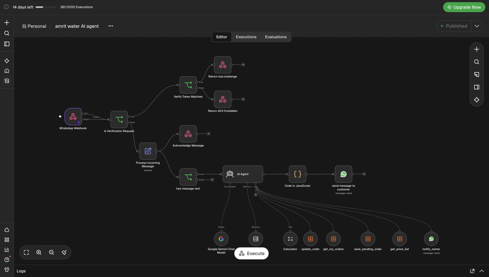
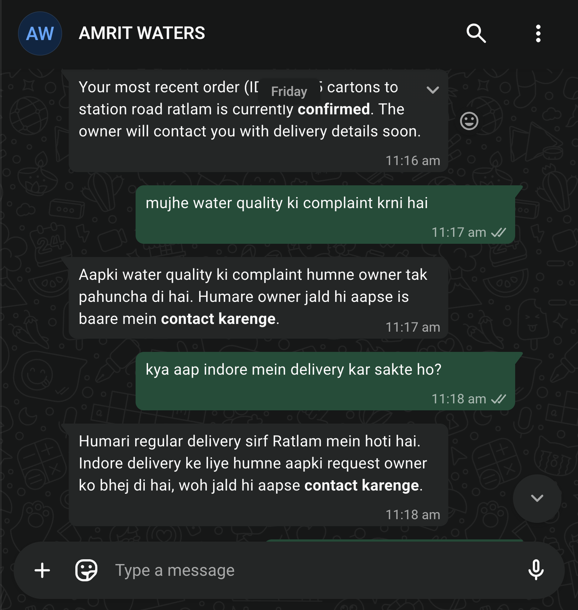
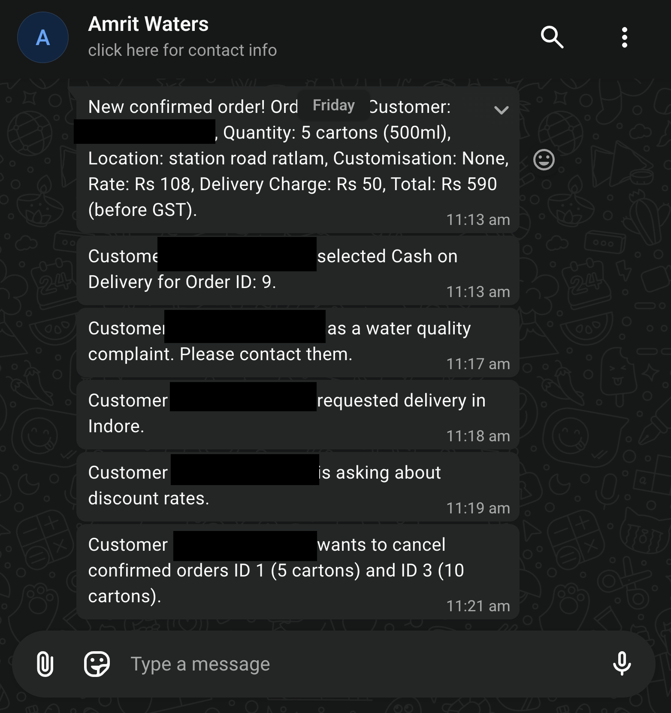
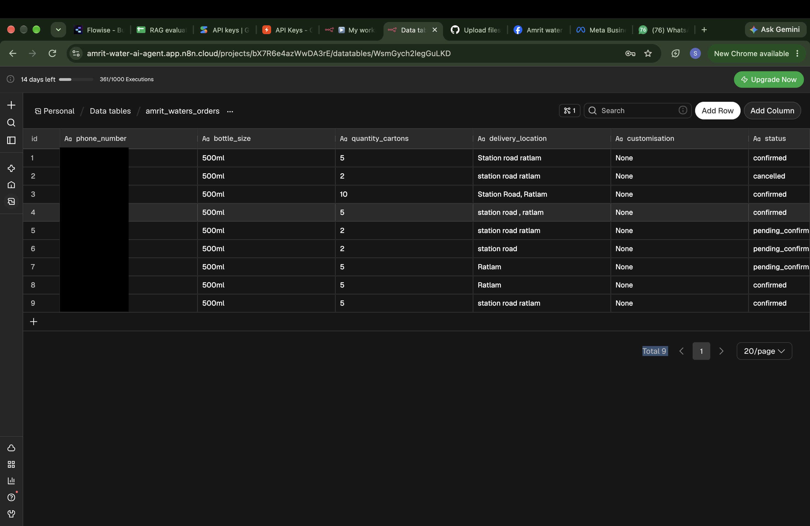
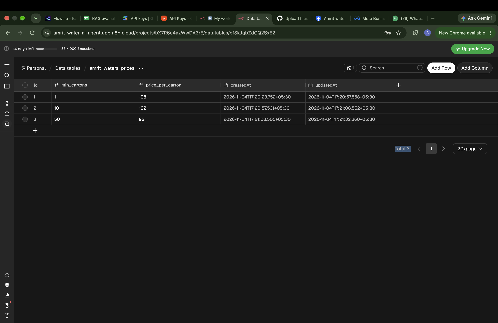

# Amrit Water: WhatsApp AI Sales & Order Agent

> A tool-using AI agent that answers price questions, takes and confirms wholesale water orders on WhatsApp, and escalates complaints, discounts and cancellations to the owner.
> **Proof of concept.** Demo rates and test data only. Not a live deployment.

**Demo video (about 3 minutes):** [amrit-water-ai-agent-demo.mp4](./amrit-water-ai-agent-demo.mp4)


https://github.com/user-attachments/assets/643ce1c3-ecaa-41ec-b95a-2e33c7f90286


---

## Version history

| Version | What it is | Status |
| --- | --- | --- |
| v1: AI assistant | Fixed flow: extract order details, apply rules, save, reply | Superseded. [Read the v1 README](./README-v1-assistant.md); v1 files stay in `docs/` and `workflow/` |
| v2: AI agent | One agent that chooses tools, remembers each customer, quotes from a price table and escalates to a human | **Current** |

Why v2 exists: in v1, general questions (price, location) got no reply, there was no memory between messages, and incomplete orders created duplicate pending rows. v2 fixes these by letting the model decide which tool to call, within strict rules.

## Business problem

A wholesale packaged-water business takes orders and questions on WhatsApp. Customers rarely give all order details in one message, quotes depend on quantity slabs and delivery rules, and every order needs a record. Handling this by hand is slow and error-prone.

## What the agent does

- Collects the order details one question at a time (bottle size, cartons, delivery location, customisation); the customer's phone number comes from WhatsApp
- Quotes prices from a rate table and calculates totals with a calculator tool, never from the model's memory
- Updates the draft when the customer changes their mind, and marks the order confirmed only after an explicit yes
- Reads order status from the orders table
- Replies in English or Hinglish, matching the customer's latest message
- Alerts the owner on WhatsApp for confirmed orders, payment choice, complaints, discount requests, deliveries outside the service area and cancellation requests
- Never cancels a confirmed order itself; the request goes to the owner

## Architecture

```
Customer (WhatsApp)
   -> Meta WhatsApp Cloud API -> n8n webhook
   -> message check -> AI Agent (Google Gemini, per-customer memory)
        tools: get_price_list | Calculator | get_my_orders |
               save_pending_order | update_order | notify_owner
   -> reply check (Code node) -> WhatsApp reply to customer
   Owner alerts -> WhatsApp message to the owner number
```

### Tools

| Tool | Purpose |
| --- | --- |
| get_price_list | Reads the rate card (carton slab and price per carton) |
| Calculator | Computes every total so the model never does its own arithmetic |
| get_my_orders | Looks up this customer's orders and statuses |
| save_pending_order | Creates the draft once all fields are known |
| update_order | Edits a draft, confirms it after a yes, or cancels a draft |
| notify_owner | Sends the owner a WhatsApp alert |

### Data (n8n Data Tables)

- `Amrit_waters_orders`: phone_number, bottle_size, quantity_cartons, delivery_location, customisation, status (pending_confirmation, confirmed, cancelled)
- `Amrit_waters_prices`: min_cartons, price_per_carton

### Guardrails

- Never invent a field, stock level, delivery time, delivery progress, price or total
- Prices only from the rate table; totals only from the Calculator
- Orders are confirmed only after an explicit yes from the customer
- A confirmed order is never cancelled by the bot
- Complaints, refunds, discounts and unknown questions go to the owner
- A reply check blocks malformed model output (for example leaked reasoning) before it reaches the customer

### Demo business rules (assumptions)

- 1 carton = 12 bottles; only 500 ml is sold
- Bottles convert to cartons only when the number is divisible by 12
- Delivery within Ratlam only: Rs 50 under 10 cartons, free from 10 cartons
- Demo rate card: 1+ cartons Rs 108, 10+ Rs 102, 50+ Rs 96 per carton, before GST
- **Rates are assumed demo values, not real Ratlam quotes**

## Tech stack

| Layer | Tool |
| --- | --- |
| Channel | WhatsApp Business Cloud API (Meta) |
| Orchestration | n8n |
| Model | Google Gemini (early testing used a Groq-hosted model) |
| Storage | n8n Data Tables |
| Memory | n8n Simple Memory, keyed by customer phone number |

## Screenshots

| n8n workflow | Order flow |
| --- | --- |
|  | (screenshots/v2-chat-order-flow-2.png) (screenshots/v2-chat-order-flow-3.png)  |

| Guardrails | Owner alerts |
| --- | --- |
|  |  |

| Orders table | Price table |
| --- | --- |
|  |  |

## Testing

Scenario-based testing through real WhatsApp conversations on a test number. A scenario passes only if the reply, the order row and the owner alert are all correct.

| # | Scenario | Expected | Result |
| --- | --- | --- | --- |
| 1 | Greeting only | Short greeting, no assumed order | Pass (after fix 4) |
| 2 | New order, one field at a time | Asks only for missing fields | Pass |
| 3 | Quantity change before confirming | Draft updated; 5 x Rs 108 + Rs 50 = Rs 590 | Pass |
| 4 | Customer says yes | Confirmed, one row, owner alerted, payment asked | Pass |
| 5 | Payment method chosen | Thanks the customer, owner notified | Pass |
| 6 | 24 bottles | Converted to 2 cartons, Rs 266 | Pass |
| 7 | 30 bottles | Asks for whole cartons | Pass |
| 8 | 60-carton price question | Rs 96 slab, Rs 5,760 | Pass |
| 9 | Delivery outside Ratlam | No quote; owner alerted | Pass |
| 10 | Water quality complaint | Apology; owner alerted | Pass |
| 11 | Cancel an unconfirmed draft | Draft set to cancelled | Pass |
| 12 | Cancel a confirmed order | Not cancelled; request sent to owner | Pass |
| 13 | Where is my order | Statuses from the table only | Pass (after fix 5) |
| 14 | English and Hinglish switching | Reply matches the latest message | Pass (after fix 4) |

### Defects found and fixed

| # | Issue | Root cause | Fix |
| --- | --- | --- | --- |
| 1 | Agent failed on real WhatsApp messages | Prompt mapped to the mock-data shape, not the live payload | Remapped to the processed message field; retested with live data |
| 2 | Wrong total (Rs 2,160 instead of Rs 2,040 for 20 cartons) | Model did its own arithmetic | Rule: totals only from the Calculator; later totals verified |
| 3 | Rate-limit errors mid-order | Free tier limit on tokens per minute | Paced tests, shortened memory; production plan uses a fallback model |
| 4 | Wrong language and stale context | Memory mirrored earlier replies | Language rule based on the latest message; fresh session keys for tests |
| 5 | Bot claimed orders were ready for delivery | No delivery data exists | Rule: report only fields in the table |
| 6 | Owner alert reached the customer chat | Change not published, and one number used for both roles | Published the workflow; separate owner number |
| 7 | A reply showed the model's internal reasoning | Reasoning-style model leaked its thinking into the output | Output rule in the prompt, a reply-check step, and a model change |

Lesson recorded: workflow changes take effect only when published, so a pre-release checklist belongs in the runbook.

### Known limitations

- Occasional formatting glitches in WhatsApp bold text
- Memory resets if n8n restarts; production needs database-backed memory
- Free-tier model limits; a paid tier and a fallback model are needed for real traffic
- No delivery scheduling, stock checks or online payment
- Abandoned drafts stay as `pending_confirmation` rows
- Demo rates; one SKU; one service area
- The title card of an earlier demo cut said "Google Sheets"; storage is n8n Data Tables

## Repository contents

```
Project-4-Amrit-Water-WhatsApp-AI-Assistant/
  README.md                          (this file, v2 agent)
  README-v1-assistant.md             original v1 README, kept for history
  amrit-water-ai-agent-demo.mp4      demo video
  docs/                              BRD and solution design (written for v1)
  screenshots/                       n8n canvas and chat screenshots
  workflow/                          sanitized n8n exports (v1, and v2 once added)
```

## Reproducing it (summary)

1. Create a Meta WhatsApp Cloud API app and a system user token; note the phone number ID
2. In n8n, import the sanitized workflow JSON and add your own credentials (WhatsApp, model)
3. Create the two data tables and add your rate card rows
4. Set a webhook verify token and point Meta's webhook at the published n8n URL
5. Paste the system prompt, set the owner number, and publish
6. Rerun the 14 test scenarios

All phone numbers, tokens and credential IDs in the exported workflow are placeholders.

## Production readiness checklist (for a real client)

- Production number and a permanent access token with a rotation date
- Fallback model and a paid model tier
- Database-backed memory and conversation logs
- Approved WhatsApp message templates for owner alerts outside the 24-hour window
- Regression tests that replay the 14 scenarios after each prompt change
- Monitoring of failed executions, and a runbook for rate changes, pausing and restarting the bot

## Roadmap

- Payment links and payment confirmation
- Stock availability checks
- Owner dashboard for orders
- Voice-note support
- Automated evaluation of replies

## Author

Saloni Sisodiya, AI Solutions Consultant. [LinkedIn](https://www.linkedin.com/in/salonee-s-201564399)

https://github.com/user-attachments/assets/e4a02a38-0da5-49b4-97d2-3ec69ea3e6e3

amrit-water-ai-agent-demo.mp4](./amrit-water-ai-agent-demo.mp4)

---

## Version history

| Version | What it is | Status |
| --- | --- | --- |
| v1: AI assistant | Fixed flow: extract order details, apply rules, save, reply | Superseded. [Read the v1 README](./README-v1-assistant.md); v1 files stay in `docs/` and `workflow/` |
| v2: AI agent | One agent that chooses tools, remembers each customer, quotes from a price table and escalates to a human | **Current** |

Why v2 exists: in v1, general questions (price, location) got no reply, there was no memory between messages, and incomplete orders created duplicate pending rows. v2 fixes these by letting the model decide which tool to call, within strict rules.

## Business problem

A wholesale packaged-water business takes orders and questions on WhatsApp. Customers rarely give all order details in one message, quotes depend on quantity slabs and delivery rules, and every order needs a record. Handling this by hand is slow and error-prone.

## What the agent does

- Collects the order details one question at a time (bottle size, cartons, delivery location, customisation); the customer's phone number comes from WhatsApp
- Quotes prices from a rate table and calculates totals with a calculator tool, never from the model's memory
- Updates the draft when the customer changes their mind, and marks the order confirmed only after an explicit yes
- Reads order status from the orders table
- Replies in English or Hinglish, matching the customer's latest message
- Alerts the owner on WhatsApp for confirmed orders, payment choice, complaints, discount requests, deliveries outside the service area and cancellation requests
- Never cancels a confirmed order itself; the request goes to the owner

## Architecture

```
Customer (WhatsApp)
   -> Meta WhatsApp Cloud API -> n8n webhook
   -> message check -> AI Agent (Google Gemini, per-customer memory)
        tools: get_price_list | Calculator | get_my_orders |
               save_pending_order | update_order | notify_owner
   -> reply check (Code node) -> WhatsApp reply to customer
   Owner alerts -> WhatsApp message to the owner number
```

### Tools

| Tool | Purpose |
| --- | --- |
| get_price_list | Reads the rate card (carton slab and price per carton) |
| Calculator | Computes every total so the model never does its own arithmetic |
| get_my_orders | Looks up this customer's orders and statuses |
| save_pending_order | Creates the draft once all fields are known |
| update_order | Edits a draft, confirms it after a yes, or cancels a draft |
| notify_owner | Sends the owner a WhatsApp alert |

### Data (n8n Data Tables)

- `Amrit_waters_orders`: phone_number, bottle_size, quantity_cartons, delivery_location, customisation, status (pending_confirmation, confirmed, cancelled)
- `Amrit_waters_prices`: min_cartons, price_per_carton

### Guardrails

- Never invent a field, stock level, delivery time, delivery progress, price or total
- Prices only from the rate table; totals only from the Calculator
- Orders are confirmed only after an explicit yes from the customer
- A confirmed order is never cancelled by the bot
- Complaints, refunds, discounts and unknown questions go to the owner
- A reply check blocks malformed model output (for example leaked reasoning) before it reaches the customer

### Demo business rules (assumptions)

- 1 carton = 12 bottles; only 500 ml is sold
- Bottles convert to cartons only when the number is divisible by 12
- Delivery within Ratlam only: Rs 50 under 10 cartons, free from 10 cartons
- Demo rate card: 1+ cartons Rs 108, 10+ Rs 102, 50+ Rs 96 per carton, before GST
- **Rates are assumed demo values, not real Ratlam quotes**

## Tech stack

| Layer | Tool |
| --- | --- |
| Channel | WhatsApp Business Cloud API (Meta) |
| Orchestration | n8n |
| Model | Google Gemini (early testing used a Groq-hosted model) |
| Storage | n8n Data Tables |
| Memory | n8n Simple Memory, keyed by customer phone number |

## Testing

Scenario-based testing through real WhatsApp conversations on a test number. A scenario passes only if the reply, the order row and the owner alert are all correct.

| # | Scenario | Expected | Result |
| --- | --- | --- | --- |
| 1 | Greeting only | Short greeting, no assumed order | Pass (after fix 4) |
| 2 | New order, one field at a time | Asks only for missing fields | Pass |
| 3 | Quantity change before confirming | Draft updated; 5 x Rs 108 + Rs 50 = Rs 590 | Pass |
| 4 | Customer says yes | Confirmed, one row, owner alerted, payment asked | Pass |
| 5 | Payment method chosen | Thanks the customer, owner notified | Pass |
| 6 | 24 bottles | Converted to 2 cartons, Rs 266 | Pass |
| 7 | 30 bottles | Asks for whole cartons | Pass |
| 8 | 60-carton price question | Rs 96 slab, Rs 5,760 | Pass |
| 9 | Delivery outside Ratlam | No quote; owner alerted | Pass |
| 10 | Water quality complaint | Apology; owner alerted | Pass |
| 11 | Cancel an unconfirmed draft | Draft set to cancelled | Pass |
| 12 | Cancel a confirmed order | Not cancelled; request sent to owner | Pass |
| 13 | Where is my order | Statuses from the table only | Pass (after fix 5) |
| 14 | English and Hinglish switching | Reply matches the latest message | Pass (after fix 4) |

### Defects found and fixed

| # | Issue | Root cause | Fix |
| --- | --- | --- | --- |
| 1 | Agent failed on real WhatsApp messages | Prompt mapped to the mock-data shape, not the live payload | Remapped to the processed message field; retested with live data |
| 2 | Wrong total (Rs 2,160 instead of Rs 2,040 for 20 cartons) | Model did its own arithmetic | Rule: totals only from the Calculator; later totals verified |
| 3 | Rate-limit errors mid-order | Free tier limit on tokens per minute | Paced tests, shortened memory; production plan uses a fallback model |
| 4 | Wrong language and stale context | Memory mirrored earlier replies | Language rule based on the latest message; fresh session keys for tests |
| 5 | Bot claimed orders were ready for delivery | No delivery data exists | Rule: report only fields in the table |
| 6 | Owner alert reached the customer chat | Change not published, and one number used for both roles | Published the workflow; separate owner number |
| 7 | A reply showed the model's internal reasoning | Reasoning-style model leaked its thinking into the output | Output rule in the prompt, a reply-check step, and a model change |

Lesson recorded: workflow changes take effect only when published, so a pre-release checklist belongs in the runbook.

### Known limitations

- Occasional formatting glitches in WhatsApp bold text
- Memory resets if n8n restarts; production needs database-backed memory
- Free-tier model limits; a paid tier and a fallback model are needed for real traffic
- No delivery scheduling, stock checks or online payment
- Abandoned drafts stay as `pending_confirmation` rows
- Demo rates; one SKU; one service area


## Repository contents

```
Project-4-Amrit-Water-WhatsApp-AI-Assistant/
  README.md                          (this file, v2 agent)
  README-v1-assistant.md             original v1 README, kept for history
  amrit-water-ai-agent-demo.mp4      demo video
  docs/                              BRD and solution design (written for v1)
  screenshots/                       n8n canvas and chat screenshots
  workflow/                          sanitized n8n exports (v1, and v2 once added)
```

## Reproducing it (summary)

1. Create a Meta WhatsApp Cloud API app and a system user token; note the phone number ID
2. In n8n, import the sanitized workflow JSON and add your own credentials (WhatsApp, model)
3. Create the two data tables and add your rate card rows
4. Set a webhook verify token and point Meta's webhook at the published n8n URL
5. Paste the system prompt, set the owner number, and publish
6. Rerun the 14 test scenarios

All phone numbers, tokens and credential IDs in the exported workflow are placeholders.

## Production readiness checklist (for a real client)

- Production number and a permanent access token with a rotation date
- Fallback model and a paid model tier
- Database-backed memory and conversation logs
- Approved WhatsApp message templates for owner alerts outside the 24-hour window
- Regression tests that replay the 14 scenarios after each prompt change
- Monitoring of failed executions, and a runbook for rate changes, pausing and restarting the bot

## Roadmap

- Payment links and payment confirmation
- Stock availability checks
- Owner dashboard for orders
- Voice-note support
- Automated evaluation of replies

## Author

Saloni Sisodiya, AI Solutions Consultant. [LinkedIn](https://www.linkedin.com/in/salonee-s-201564399)
